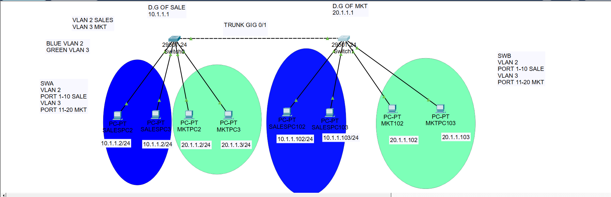

# VLAN Segmentation & Trunking Lab (Cisco Packet Tracer)

A hands-on lab that segments a small network into **Sales** and **Marketing** VLANs across two Cisco 2950T-24 switches connected by an 802.1Q trunk.




## Objectives
- Create and name VLANs on multiple switches
- Assign access ports to VLANs
- Configure a trunk link so VLANs span two switches
- Verify intra-VLAN connectivity and inter-VLAN isolation

## Topology

| Item | Details |
|------|---------|
| Switches | 2 x Cisco 2950T-24 (SWA = Switch0, SWB = Switch1) |
| Trunk link | Gig 0/1 between SWA and SWB |
| VLAN 2 (SALES) | Ports 1-10, subnet 10.1.1.0/24, gateway 10.1.1.1 |
| VLAN 3 (MKT) | Ports 11-20, subnet 20.1.1.0/24, gateway 20.1.1.1 |

## IP Addressing

| Device | Switch | VLAN | IP Address |
|--------|--------|------|------------|
| SALESPC2 | SWA | 2 (Sales) | 10.1.1.2/24 |
| SALESPC3 | SWA | 2 (Sales) | 10.1.1.3/24 |
| MKTPC2 | SWA | 3 (MKT) | 20.1.1.2/24 |
| MKTPC3 | SWA | 3 (MKT) | 20.1.1.3/24 |
| SALESPC102 | SWB | 2 (Sales) | 10.1.1.102/24 |
| SALESPC103 | SWB | 2 (Sales) | 10.1.1.103/24 |
| MKT102 | SWB | 3 (MKT) | 20.1.1.102/24 |
| MKTPC103 | SWB | 3 (MKT) | 20.1.1.103/24 |

Default gateways: **10.1.1.1** (Sales), **20.1.1.1** (Marketing).

> Note: the original diagram labels both SALESPC2 and SALESPC3 as 10.1.1.2. Two hosts cannot share an IP, so SALESPC3 is listed here as 10.1.1.3. Adjust to match your actual setup.

## Configuration

Full configs are in [`configs/`](configs/):
- [`swa.txt`](configs/swa.txt)
- [`swb.txt`](configs/swb.txt)

Core commands (identical on both switches apart from the hostname):

```
vlan 2
 name SALES
vlan 3
 name MKT

interface range fastEthernet 0/1-10
 switchport mode access
 switchport access vlan 2

interface range fastEthernet 0/11-20
 switchport mode access
 switchport access vlan 3

interface gigabitEthernet 0/1
 switchport mode trunk
```

## Verification

Run on each switch:

```
show vlan brief
show interfaces trunk
show running-config
```

Expected ping results:

| Test | Result |
|------|--------|
| SALESPC2 -> SALESPC102 (same VLAN, across trunk) | Success |
| MKTPC2 -> MKT102 (same VLAN, across trunk) | Success |
| SALESPC2 -> MKTPC2 (different VLANs) | Fail (no inter-VLAN routing yet) |

## Key Takeaways
- VLANs separate broadcast domains and improve security.
- A trunk carries multiple VLANs over a single physical link.
- VLAN IDs must be defined on both switches for traffic to cross the trunk.
- Communication between VLANs requires a Layer 3 device.

## Future Work
- [ ] Inter-VLAN routing with router-on-a-stick (sub-interfaces for 10.1.1.1 and 20.1.1.1)
- [ ] Layer 3 switch with SVIs
- [ ] DHCP per VLAN
- [ ] Port security and a restricted trunk allowed-VLAN list

## How to Run
1. Install [Cisco Packet Tracer](https://www.netacad.com/courses/packet-tracer).
2. Open `vlan-trunking-lab.pkt`.
3. Open each switch CLI and verify with the commands above, or paste the configs from `configs/`.

## Tools
Cisco Packet Tracer, Cisco IOS CLI

## Author
Manzar Ali Khan - [LinkedIn](https://www.linkedin.com/in/manzar-ali-902910342)

## License
MIT
